# ML Fundamentals: visual notes

Short, plain-language notes on core machine learning concepts, each with a diagram, plus two interactive demos. Built around one running example (predicting a house's price) so the pieces connect.

## Contents

| # | Notes | Diagrams |
|---|---|---|
| 1 | [Core concepts](docs/01-core-concepts.md): features, labels, training, inference, batch/step/epoch, training time | features and label, training loop, inference |
| 2 | [Model families](docs/02-model-families.md): MLPs and where they are used, trees, embeddings, LLMs, reinforcement learning | MLP, decision tree, embedding space, next-token prediction, RL loop |
| 3 | [Training components](docs/03-training-components.md): batch/layer norm, SGD/momentum/Adam, dropout, weight decay, residuals, optimization techniques | batch vs layer norm |
| 4 | [Generalization and evaluation](docs/04-generalization-and-evaluation.md): overfitting, training-serving skew, class imbalance, calibration | reliability diagram |
| 5 | [Fine-tuning](docs/05-fine-tuning.md): full, frozen layers, LoRA, catastrophic forgetting | fine-tuning layers |
| 6 | [Transformers, attention and temperature](docs/06-transformers-attention-temperature.md): pipeline, queries/keys/values with a worked example, multi-head, causal mask, transformer block, position info, KV cache, temperature and sampling | pipeline, block, attention steps, attention weights, causal mask, multi-head, temperature |
| 7 | [Quick reference and self-test](docs/07-quick-reference-and-self-test.md): cheat sheet, common mix-ups, practice questions | none |

## Interactive demos

These are standalone HTML files. GitHub shows HTML as source, so either open them locally in a browser or enable GitHub Pages for the repo to host them.

- [`demos/training-demo.html`](demos/training-demo.html): fit a line to house-price data one gradient step at a time. Raise the learning rate to see it overshoot.
- [`demos/optimizer-race.html`](demos/optimizer-race.html): SGD vs momentum vs Adam on a narrow valley.

## Diagram gallery

All diagrams live in [`diagrams/`](diagrams/) as standalone SVGs, so they render directly on GitHub.

| | |
|---|---|
| 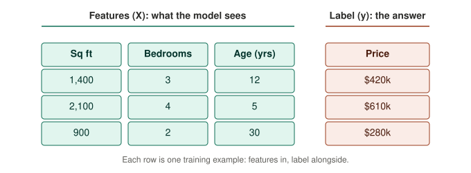 | 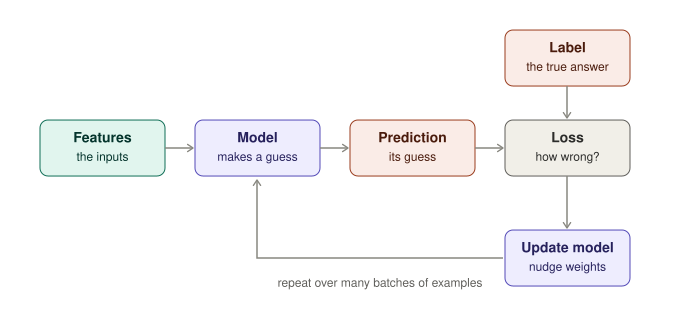 |
| 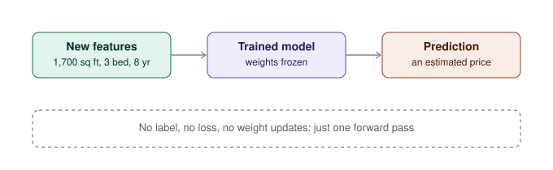 | 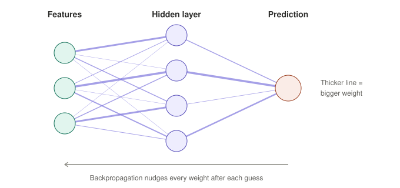 |
| 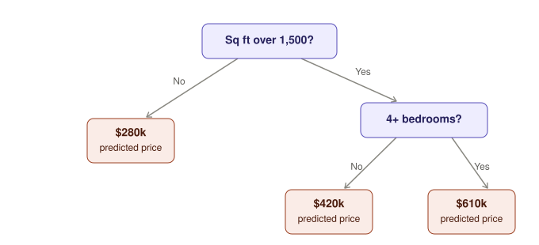 | 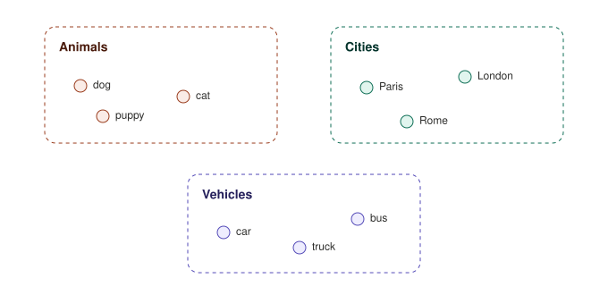 |
| 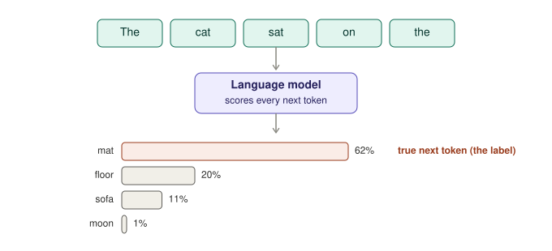 | 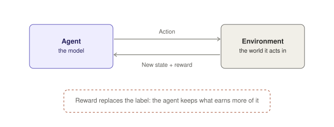 |
|  |  |
| 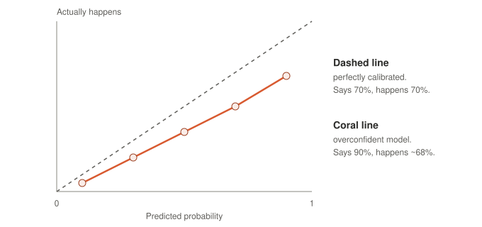 | 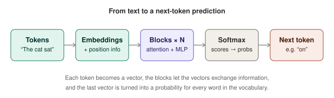 |
| 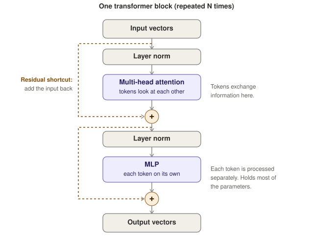 | 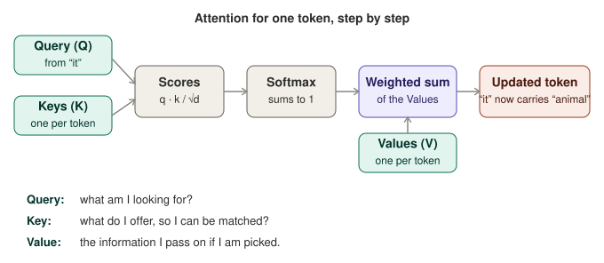 |
| 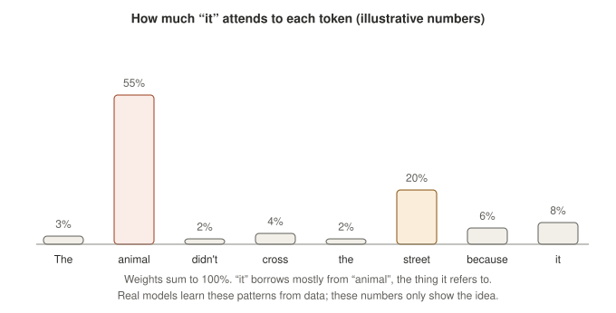 | 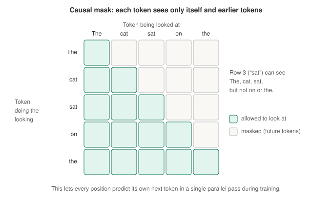 |
| 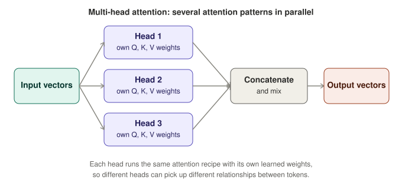 | 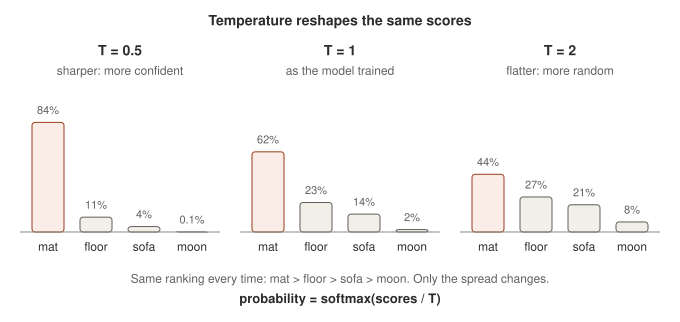 |

## The big picture in one paragraph

Training uses features plus labels to adjust a model's weights: guess, measure the error (loss), nudge the weights, repeat over many batches. Inference uses features alone and the frozen weights to produce a prediction. Different model families change what the training signal is (labels, the next token, a reward, or nothing) and what gets adjusted (weights, tree splits, point positions, behavior). Normalization, optimizers and regularization keep that loop stable and keep the model from memorizing its training data.
