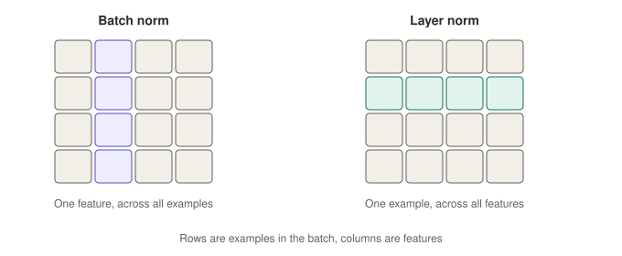

# 03 · Training components: normalization, optimizers, and optimization techniques

Quick map: **normalization** keeps the numbers inside the network well-behaved. The **optimizer** decides how the weights get nudged. The **schedule** decides how big the steps are over time.

## Normalization

Numbers drift in scale as they pass through many layers, which makes training unstable. Normalizing re-centers activations to mean 0 and spread 1 at each layer.

> Note: norm layers smooth the **activations** (numbers flowing between layers), not the raw input features. Scaling raw features before training is a separate step called feature standardization. Norm layers also have a learned scale and shift, so the network can undo the normalization if that helps.

| | Normalizes | Memory trick | Used in |
|---|---|---|---|
| **Batch norm** | One feature across all examples in the batch (a column) | Compare yourself to your classmates | CNNs |
| **Layer norm** | One example across all of its features (a row) | Compare yourself to yourself | Transformers, LLMs |

Layer norm depends only on a single example, so it works with batch size 1. Batch norm depends on the other items in the batch: with a batch of one, the batch variance is zero and there is nothing meaningful to normalize against.

## Optimizers

An optimizer is the rule that turns gradients into weight updates. The learning rate is a setting they all use.

- **SGD:** take a step downhill using the current slope.
- **Momentum:** a rolling ball that keeps part of its previous direction, smoothing zigzags.
- **Adam:** momentum plus a **per-weight step size**. It divides each weight's step by a running average of its recent squared gradients, so large-gradient directions get damped and small-gradient directions get boosted. Works well with little tuning, so it is the usual default.
- **AdamW:** Adam with weight decay done properly; the usual choice for transformers.

Try it: [`demos/optimizer-race.html`](../demos/optimizer-race.html) races SGD, momentum and Adam down a narrow valley.

- SGD zigzags across the valley while creeping along the floor.
- Momentum builds speed but overshoots and swings.
- Adam damps the steep direction and boosts the shallow one, heading more directly to the minimum.

Real loss surfaces are far bumpier, so Adam is not always the winner; well-tuned SGD with momentum still wins on some vision tasks.

## Other training terms

- **Learning rate schedule and warmup:** start with tiny steps, ramp up, then shrink over time. Often the single most impactful knob.
- **Dropout:** randomly switch off units during training so the network cannot lean on any single one. **Off at inference** (all units active). Leaving it on would make predictions random: the same input could give different outputs.
- **Weight decay:** a gentle pull of all weights toward zero, discouraging overfitting.
- **Residual connection:** a shortcut that adds a layer's input to its output, so signals and gradients flow through deep networks easily.

A typical transformer stack: residual connections plus layer norm, trained with AdamW, a warmup schedule, and sometimes dropout.

## Optimization techniques (the full checklist)

The goal: get the loss down quickly and stably. Picture walking downhill in fog. Each technique fixes a different way the walk can go wrong.

- **Learning rate:** too big and you overshoot or blow up; too small and you crawl. Usually the most sensitive setting.
- **Learning rate schedule:** warmup (early gradients are unreliable), then larger steps, then shrink so you settle into the minimum. Cosine or step decay are common.
- **Optimizer:** SGD with momentum, or Adam/AdamW.
- **Batch size:** bigger batches give smoother gradients and better hardware use; small batches are noisier, which can act as mild regularization. Tune batch size and learning rate together.
- **Gradient clipping:** a speed limit. If a gradient gets huge, cap its size so one bad batch cannot throw the weights far away. Common in transformers and sequence models.
- **Normalization and residual connections:** keep activations and gradients well-behaved in deep nets.
- **Regularization and early stopping:** weight decay, dropout, and stopping when held-out performance stops improving.
- **Mixed precision:** cheaper number formats for most math; faster and uses less memory.
- **Gradient accumulation:** add up gradients over several small batches before one update, to mimic a large batch on limited memory.
- **Hyperparameter search:** random or Bayesian search usually beats grid search, because only a few hyperparameters (often learning rate) matter most and random search tries more distinct values of each.

Next: [04 · Generalization and evaluation](04-generalization-and-evaluation.md)
