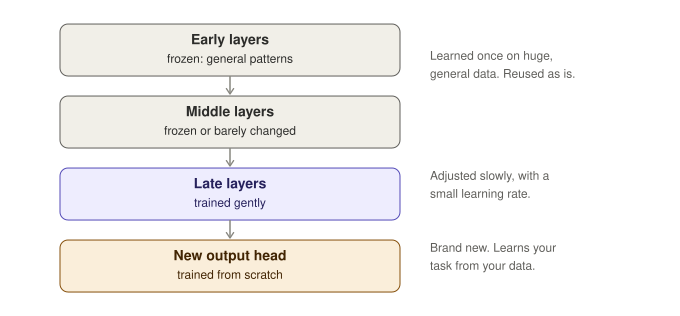

# 05 · Fine-tuning

## The idea

Training from scratch is like teaching someone to read, write and reason from birth. Fine-tuning starts with someone who already has those skills and teaches them your specific job. That "someone" is a **pretrained model**: already trained on a huge general dataset, so it knows useful patterns (grammar and meaning in text, edges and shapes in images).

**Recipe:**

1. Take the pretrained model.
2. Keep training it on your smaller, task-specific dataset.
3. Use a small learning rate, so you nudge the weights gently instead of overwriting what it knows.

Layers learn at different levels: early layers capture general patterns that apply almost anywhere, later layers capture task-specific ones. That is why you can reuse the early ones and adjust the later ones.

## Three common ways

- **Full fine-tuning:** update every weight. Most flexible, most compute and memory.
- **Freezing layers:** lock most layers and train only the late ones plus a new head. Cheap and works well with little data.
- **LoRA (parameter-efficient):** leave the original weights untouched and add tiny trainable "side patches" next to them. Like sticky notes on a textbook instead of rewriting the book. You train a small fraction of the parameters and can keep one small patch per task.

## Main risk: catastrophic forgetting

Train too hard on the new data and the model loses the general abilities it started with. Fixes: low learning rate, fewer training steps, freeze most of the model, and validate on both the new task and general behavior.

## When to fine-tune

Prompting and retrieval (RAG) change what the model **sees**; fine-tuning changes the model **itself**. Reach for fine-tuning when you need consistent style, format or domain behavior that prompting cannot reliably give you.

Next: [06 · Transformers, attention and temperature](06-transformers-attention-temperature.md)
