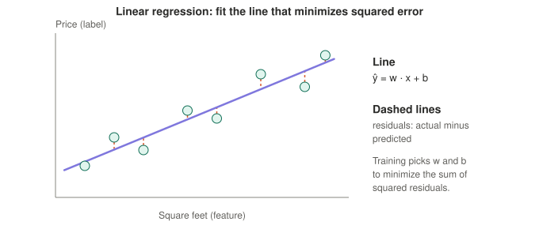
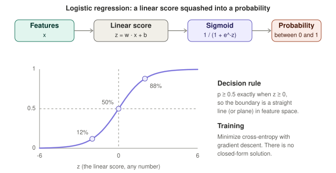
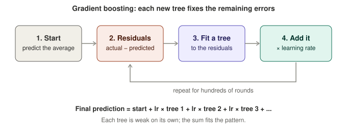
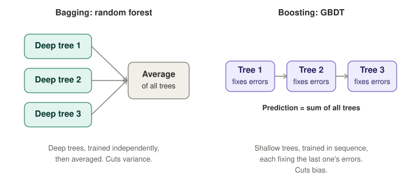

# 07 · Classical models: linear regression, logistic regression, trees, random forests, GBDT

These come up constantly in ML fundamentals rounds, and they are the baselines to beat on tabular data. Running example: the house-price table from [01](01-core-concepts.md).

## 1. Linear regression

**Idea:** predict a number as a weighted sum of the features.

> ŷ = w₁·x₁ + w₂·x₂ + ... + b

Each weight says how much the prediction moves per unit of that feature, holding the others fixed. The bias b is the baseline when all features are zero.

**How it is fit.** Choose w and b to minimize the **mean squared error** (the average of squared residuals, where a residual is actual minus predicted). Two ways to do it:

- **Closed form (normal equation):** w = (XᵀX)⁻¹ Xᵀ y. Exact, but expensive with many features.
- **Gradient descent:** the same loop as [01](01-core-concepts.md): guess, measure the loss, nudge the weights. The interactive [`training-demo.html`](../demos/training-demo.html) is exactly this, fitting a line to house prices.

**Worked example.** Square feet in hundreds x = [9, 14, 21], price in $k y = [280, 420, 610]. The least-squares fit is **ŷ = 27.48·x + 33.67**, so each extra 100 sq ft adds about $27.5k. Predictions are 281.0, 418.3 and 610.7, residuals −1.0, +1.7 and −0.7. A new 1,700 sq ft house (x = 17) is predicted at about **$501k**.

**Assumptions and failure modes**

| Issue | What goes wrong | Typical fix |
|---|---|---|
| Relationship is not linear | Systematic misfit | Add transformed or polynomial features, or use trees or a neural net |
| Outliers | Squaring makes them dominate the fit | Huber or MAE loss, remove or cap outliers |
| Correlated features (multicollinearity) | Coefficients become unstable and hard to interpret | Drop or combine features, ridge regularization |
| Extrapolating beyond the data | The line keeps going, even when reality does not | Be careful; trees cannot extrapolate either |
| Features on different scales | Gradient descent is slow; regularization penalizes unevenly | Standardize features |

Regularized versions (ridge, lasso, elastic net) are in [08](08-theory-and-evaluation.md).

**Say it:** "Linear regression predicts a number as a weighted sum of the features. I fit the weights by minimizing squared error, either with the closed-form normal equation or gradient descent. It's interpretable and a good baseline, but it assumes a linear relationship, it's sensitive to outliers because errors are squared, and correlated features make the coefficients unstable, which ridge regularization helps with."

## 2. Logistic regression

**Idea:** the classification cousin of linear regression, despite the name. Compute the same linear score, then squash it into a probability with the **sigmoid**.

> z = w·x + b  →  p = 1 / (1 + e⁻ᶻ)

- z can be any number; the sigmoid maps it to between 0 and 1. z = −2, 0, 2 gives p ≈ 12%, 50%, 88%.
- **Log-odds are linear.** log(p / (1 − p)) = w·x + b. At p = 0.8 the odds are 4 to 1 and the log-odds are 1.386. A weight w means each unit of that feature multiplies the odds by e^w (the odds ratio).
- **Decision boundary is linear.** p ≥ 0.5 exactly when z ≥ 0, which is a straight line (or plane) in feature space. The 0.5 threshold is a choice; tune it to the cost of each error type (see [04](04-generalization-and-evaluation.md)).
- **Multi-class:** replace the sigmoid with **softmax** over one score per class.

**Training uses cross-entropy, not squared error.** For one example, loss = −[y·log p + (1−y)·log(1−p)].

| True label | Prediction p | Loss |
|---|---|---|
| 1 | 0.9 (confident, right) | 0.105 |
| 1 | 0.1 (confident, wrong) | 2.303 |

Why cross-entropy is the right choice:

1. It is the **negative log-likelihood** of the data under the model, so minimizing it is maximum likelihood estimation.
2. For logistic regression the loss is **convex**, so gradient descent finds the single global minimum. There is no closed-form solution, so you always train it iteratively.
3. Its gradient with respect to the score z is simply **(p − y)**: the bigger the mistake, the bigger the push. With squared error the gradient picks up an extra p(1−p) factor, which is almost zero when the sigmoid saturates, so a confidently wrong model barely learns.

**Link to neural networks.** One sigmoid neuron *is* logistic regression. The last layer of a classification network is logistic (or softmax) regression applied to features the earlier layers learned.

**Strengths:** fast, interpretable, a strong baseline, probabilities that are often reasonably calibrated, easy to serve. It is a classic click-through-rate baseline, usually with hand-built feature crosses.

**Weaknesses:** linear boundary, so interactions between features must be engineered by hand. If the classes are perfectly separable, the weights grow without bound unless you regularize. Regularization needs scaled features.

**Say it:** "Logistic regression computes a linear score and passes it through a sigmoid to get a probability. The log-odds are linear in the features, so the decision boundary is linear. I train it with cross-entropy, which is maximum likelihood; it's convex and its gradient is just prediction minus label, so a confident wrong answer gets a strong correction. It's a fast, interpretable baseline, and a single neuron with a sigmoid is the same thing."

## 3. Decision trees: how a split is chosen

A tree asks yes/no questions about features and ends in leaves that hold a prediction (see the tree in [02](02-model-families.md)). Training is **greedy**: at each node, try candidate splits (a feature and a threshold) and keep the one that most reduces **impurity** in the children.

- **Classification impurity:** Gini = 1 − Σ pₖ² (0 for a pure node, 0.5 for a 50/50 binary node), or entropy.
- **Regression impurity:** the variance of the targets; a leaf predicts the mean of its examples.
- **Stop** with a maximum depth, a minimum number of examples per leaf, or by pruning afterwards.

**Pros:** interpretable, no feature scaling, handles nonlinearity, interactions and mixed feature types.
**Cons:** one deep tree is unstable (a small data change gives a very different tree) and overfits: high variance. Ensembles fix this.

## 4. Random forest (bagging)

Train many deep trees **independently**, each on a **bootstrap sample** (rows drawn with replacement) and with a random subset of features considered at each split, then **average** their predictions (or vote). Averaging many noisy but roughly unbiased trees cuts **variance**.

- Hard to overfit by adding more trees, trains in parallel, little tuning needed.
- Usually a bit less accurate than well-tuned boosting, and the model is large.

## 5. GBDT: gradient boosted decision trees

Train many **shallow** trees **in sequence**. Each new tree is fit to the **errors of the ensemble so far**, and the prediction is the sum of all trees, each scaled by a small **learning rate**.

**Why "gradient"?** The thing each tree fits is the negative gradient of the loss with respect to the current predictions. For squared error that is exactly the residual (actual − predicted). For log loss it is y − p. So the same recipe works for regression, classification and ranking, just by changing the loss.

### Worked example

Three houses, one stump (a tree with one split: "sq ft over 1,000?"), learning rate 0.5.

| House | Actual | Start (mean) | Residual | Tree 1 leaf | New prediction | New residual |
|---|---|---|---|---|---|---|
| A (900 sq ft) | 280 | 436.67 | −156.67 | −156.67 | 436.67 + 0.5 × (−156.67) = 358.33 | −78.33 |
| B (1,400 sq ft) | 420 | 436.67 | −16.67 | +78.33 | 436.67 + 0.5 × 78.33 = 475.83 | −55.83 |
| C (2,100 sq ft) | 610 | 436.67 | +173.33 | +78.33 | 475.83 | +134.17 |

The right-hand leaf predicts the **mean** of B's and C's residuals (78.33). Total squared error falls from about 54,870 to about 27,250 after one tree. House B actually got slightly worse, because it shares a leaf with C; the next tree will split B from C and fix it. That is the whole idea: each round chips away at what is left.

### Key hyperparameters

| Setting | Effect |
|---|---|
| Number of trees | More fits more; too many overfits. Use **early stopping** on a validation set |
| Learning rate (shrinkage) | Smaller steps need more trees but generalize better |
| Max depth (usually 3 to 8) | Deeper trees capture bigger interactions but overfit |
| Row and column subsampling | Adds randomness, reduces overfitting and speeds training |
| Regularization (min child weight, L2 on leaf values) | Keeps individual trees from fitting noise |

Popular implementations: **XGBoost, LightGBM, CatBoost** (CatBoost handles categorical features natively).

### Strengths and limits

- **Strong on tabular data:** handles mixed scales and types, missing values (in the main implementations), nonlinearity and interactions, with little preprocessing. It often beats neural nets on small to medium tabular datasets.
- **Used in ranking:** **LambdaMART** is GBDT trained with a ranking loss that cares about NDCG; it has long been a workhorse for search ranking.
- **Cannot extrapolate:** every prediction is a sum of leaf values seen in training, so it will not go beyond the training range of the target.
- **More tuning than a random forest**, can overfit without early stopping, and is a poor fit for raw images, audio and text (use embeddings or neural nets there). Training is sequential across trees, though each tree itself can be parallelized.

**Say it:** "GBDT builds shallow trees in sequence, and each tree is fit to the residuals, more precisely the negative gradient of the loss, of the ensemble so far. The final prediction is the sum of the trees scaled by a learning rate. Compared with a random forest, which averages deep independent trees to cut variance, boosting reduces bias step by step. It's usually the strongest choice for tabular data, and LambdaMART uses it for ranking. The risks are overfitting without early stopping and no extrapolation beyond the training range."

## 6. Bagging vs boosting

| | Random forest (bagging) | GBDT (boosting) |
|---|---|---|
| Trees | Deep, independent | Shallow, sequential |
| Combine by | Averaging | Summing scaled trees |
| Mainly reduces | Variance | Bias (and variance with shrinkage) |
| Parallel training | Yes, across trees | No, trees depend on earlier ones |
| Tuning | Little | More |
| Typical accuracy | Good | Usually best on tabular data |

## 7. Choosing a model

| Situation | Reach for |
|---|---|
| Need a fast, interpretable baseline for a number | Linear regression |
| Need a fast, interpretable baseline for a class or probability | Logistic regression |
| Tabular data, want the best accuracy | GBDT (then compare to an MLP) |
| Tabular data, want something robust with minimal tuning | Random forest |
| Ranking or recommendations with rich features and embeddings | MLP or two-tower models, often alongside GBDT |
| Images, audio, text | CNNs, transformers, pretrained models plus fine-tuning |
| Need to explain individual predictions to stakeholders | Linear or logistic models, or small trees |
| Very little data | Simple, regularized models |

## 8. Other classical models in one paragraph each

| Model | What it does | Remember |
|---|---|---|
| **k-nearest neighbors** | Predict from the k closest training examples | No training step, but slow at inference and hurt by many features and unscaled features |
| **Naive Bayes** | Applies Bayes' rule assuming features are independent given the class | Very fast, works surprisingly well on text, but the independence assumption is wrong and probabilities are poorly calibrated |
| **SVM** | Finds the boundary with the widest margin; kernels allow curved boundaries | Strong on small, clean datasets; scales poorly to huge data; hinge loss |
| **k-means** | Unsupervised clustering: assign points to the nearest of k centers, move the centers, repeat | Must choose k; assumes round clusters; sensitive to initialization and scaling |
| **PCA** | Finds the directions of greatest variance and projects the data onto the top few | Linear dimensionality reduction; scale first; components are not always interpretable |

## 9. Self-test

1. What does linear regression minimize, and how can it be fit two ways?
2. In logistic regression, what is linear in the features, and why is the decision boundary linear?
3. Why train logistic regression with cross-entropy instead of squared error? What is the gradient with respect to the score?
4. Why is a single neuron with a sigmoid the same as logistic regression?
5. How does a decision tree pick a split? What is Gini impurity?
6. Random forest vs GBDT: how are the trees trained and combined, and which reduces variance and which reduces bias?
7. In GBDT, what does each new tree fit? Why is it called "gradient"?
8. In the worked example, why did house B get worse after the first tree?
9. Name four GBDT hyperparameters and what each does. How do you decide how many trees?
10. Why can't tree models extrapolate? Name one more GBDT weakness.
11. Given tabular data with 50k rows, which models would you try first, and why?
12. Which classical models need feature scaling, and which don't?

Next: [08 · Theory and evaluation](08-theory-and-evaluation.md)
