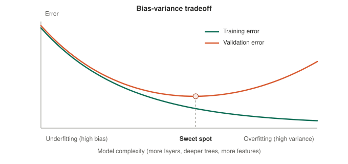
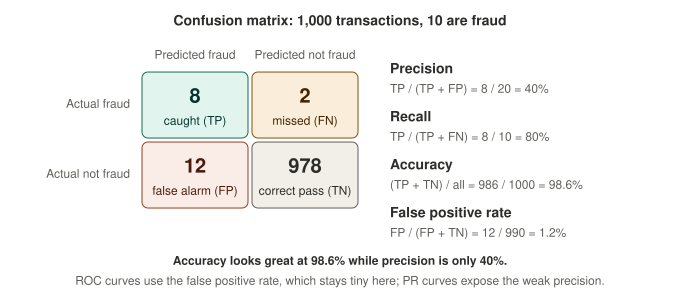
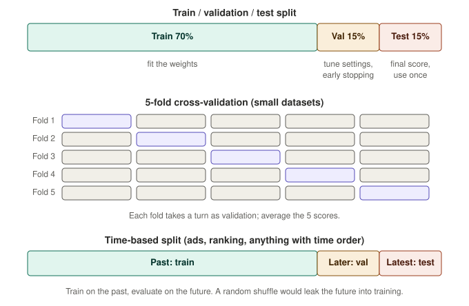

# 08 · Theory and evaluation: bias-variance, regularization, losses, backprop, metrics, validation

The ideas interviewers lean on to test depth. Many of them connect back to earlier chapters.

## 1. Bias-variance tradeoff

Expected prediction error splits into three parts:

> error = **bias²** + **variance** + irreducible noise

- **Bias:** error from a model too simple to capture the real pattern (a straight line through a curve). The model is consistently wrong in the same direction.
- **Variance:** error from a model too sensitive to the particular training sample. Train it on a different sample and it changes a lot. This is overfitting.
- **Noise:** randomness in the data that no model can remove.

As complexity grows, bias falls and variance rises. Training error only ever falls; validation error falls and then turns up. The minimum of validation error is the sweet spot.

### Diagnose with training vs validation error

| Training error | Validation error | Diagnosis | What helps |
|---|---|---|---|
| High | High (about the same) | **High bias** (underfitting) | Bigger or more flexible model, better features, train longer, less regularization |
| Low | High (big gap) | **High variance** (overfitting) | More data, regularization, dropout, early stopping, simpler model, bagging |
| Low | Low | Good fit | Ship it, then check for skew in production (see [04](04-generalization-and-evaluation.md)) |

Ensembles connect here: bagging (random forest) cuts variance, boosting cuts bias ([07](07-classical-models.md)).

**Say it:** "Error decomposes into bias squared, variance and irreducible noise. Bias is error from a model that's too simple, and variance is error from a model that's too sensitive to the training sample. I tell them apart by comparing training and validation error: both high means bias, so I add capacity or better features; low training but high validation means variance, so I add data or regularization. Complexity trades one for the other."

## 2. Regularization

Add a penalty to the loss that discourages large weights, so the model prefers simpler fits. λ sets the strength and is chosen on validation data. Standardize features first so the penalty treats them equally.

| | L2 (ridge, weight decay) | L1 (lasso) |
|---|---|---|
| Penalty | λ · Σ w² | λ · Σ \|w\| |
| Effect | Shrinks all weights smoothly | Pushes many weights **exactly to zero** (sparse model, feature selection) |
| Why | Gradient 2λw is proportional to w, so tiny weights shrink slowly and never hit zero | Gradient λ·sign(w) is a constant push, so small weights are driven to exactly zero |
| Bayesian view | Gaussian prior on weights | Laplace prior on weights |
| Good when | Many small, correlated effects | Few features really matter, or you want interpretability |

- **Elastic net** combines both penalties.
- **Weight decay vs L2:** identical for plain SGD. With Adam, the adaptive step rescales the L2 gradient, so the penalty behaves unevenly. **AdamW** applies the decay directly to the weights instead, which is why it is the transformer default ([03](03-training-components.md)).
- **Other regularizers:** dropout, early stopping, data augmentation, smaller models, ensembling, and more data (the best one).

**Say it:** "Regularization adds a penalty on the weights so the model prefers simpler solutions. L2 shrinks all weights smoothly, L1 drives some exactly to zero, giving sparsity and feature selection, because its gradient is a constant push regardless of weight size. In neural nets I use weight decay, usually AdamW, plus dropout and early stopping."

## 3. Loss functions

The loss is the number training minimizes. Match it to the task and to what mistakes cost.

| Loss | Used for | Notes |
|---|---|---|
| **MSE** (mean squared error) | Regression | Smooth, but outliers dominate because errors are squared |
| **MAE** (mean absolute error) | Regression | Robust to outliers; predicts the median; not smooth at 0 |
| **Huber** | Regression | Squared for small errors, linear for large ones; a compromise |
| **Binary cross-entropy** (log loss) | Binary classification | Maximum likelihood; punishes confident wrong answers heavily |
| **Categorical cross-entropy** | Multi-class, and next-token prediction in LLMs | Softmax output, −log of the probability given to the right class |
| **Hinge** | SVMs | Cares only about examples inside or on the wrong side of the margin |
| **Pairwise / listwise ranking losses** | Ranking | Learn the order of items, not absolute scores; LambdaMART and many neural rankers use these |
| **Contrastive** | Embeddings, two-tower retrieval | Pull matching pairs together, push non-matching pairs apart |

**Loss vs metric.** The loss must be differentiable so gradient descent can use it. The metric (accuracy, NDCG) is what you report and may not be differentiable. They are related but not the same, which is why you sometimes optimize one and monitor another.

## 4. Backpropagation, activations and vanishing gradients

**Backpropagation** computes how the loss changes with respect to every weight, using the chain rule.

1. **Forward pass:** compute each layer's output from input to prediction, saving the intermediate values.
2. **Loss:** compare with the label.
3. **Backward pass:** starting at the loss, multiply local derivatives layer by layer back toward the input. Each weight's gradient is roughly (the error signal arriving from above) × (the activation arriving from below).
4. **Update:** the optimizer ([03](03-training-components.md)) uses those gradients to change the weights.

The backward pass costs about as much as one or two forward passes, which is why training is feasible.

### Activation functions

Without a nonlinearity, stacked layers collapse into one linear function ([02](02-model-families.md)).

| Activation | Formula | Notes |
|---|---|---|
| **Sigmoid** | 1 / (1 + e⁻ᶻ) | Output 0 to 1; saturates (flat) at both ends; derivative at most 0.25. Used for output probabilities and gates, rarely in hidden layers |
| **Tanh** | (eᶻ − e⁻ᶻ) / (eᶻ + e⁻ᶻ) | Output −1 to 1, zero-centered, but still saturates |
| **ReLU** | max(0, z) | Gradient is 1 for positive z, 0 otherwise. Cheap and the classic default. Risk: "dead" units stuck at 0 |
| **GELU / SiLU** | Smooth ReLU-like curves | Common in transformers |
| **Softmax** | eᶻⁱ / Σ eᶻʲ | Turns scores into probabilities that sum to 1; used at the output for multi-class |

### Vanishing and exploding gradients

The backward pass multiplies many local derivatives. If each is below 1, the product shrinks toward zero; if each is above 1, it blows up.

- **Vanishing:** the sigmoid's derivative is at most 0.25, so after 10 layers the signal is scaled by up to 0.25¹⁰ ≈ 0.000001. Early layers barely learn.
- **Exploding:** gradients grow and updates throw the weights far away. Loss turns to NaN.

**Fixes:** ReLU or GELU activations, **residual connections** (an identity path for gradients), **normalization**, careful **weight initialization** (He or Xavier scaling keeps activation size stable across layers), and **gradient clipping** for exploding gradients.

## 5. Evaluation metrics

### Classification

- **Precision** = TP / (TP + FP): of what I flagged, how much was right?
- **Recall** (sensitivity) = TP / (TP + FN): of all real positives, how many did I catch?
- **F1** = 2PR / (P + R), the harmonic mean. For the example, P = 0.40 and R = 0.80 give F1 = 0.533.
- **Accuracy** misleads under imbalance (98.6% above, with 40% precision).
- Raising the threshold raises precision and lowers recall; lowering it does the opposite. Pick it by the business cost of each error.

**ROC-AUC vs PR-AUC**

- **ROC curve:** true positive rate (recall) vs false positive rate (FP / (FP + TN)) across all thresholds. **ROC-AUC** is the probability that a random positive is scored above a random negative; 0.5 is chance.
- **PR curve:** precision vs recall across thresholds. **PR-AUC** (average precision) focuses on the positive class.
- With rare positives, the false positive rate stays tiny because there are so many negatives (12 / 990 = 1.2% above), so ROC-AUC can look excellent while precision is poor. **Prefer PR-AUC under heavy imbalance.**
- Both measure ranking only, not calibration ([04](04-generalization-and-evaluation.md)).

### Regression

- **RMSE** (same units as the target, penalizes big errors), **MAE** (robust, easy to explain), **R²** = 1 − SSE / total variance (fraction of variance explained; can be negative for a bad model).

### Ranking and recommendations

- **Precision@k, Recall@k:** quality of the top k results.
- **MRR** (mean reciprocal rank): average of 1 / rank of the first relevant result. First relevant at ranks 1, 3, 2 gives (1 + 1/3 + 1/2) / 3 = 0.611.
- **NDCG@k:** rewards putting highly relevant items near the top. DCG = Σ relevance / log₂(position + 1).

Worked NDCG: graded relevance in the order the model ranked them is [3, 2, 0, 1].

| Position | 1 | 2 | 3 | 4 | DCG |
|---|---|---|---|---|---|
| Relevance | 3 | 2 | 0 | 1 | |
| Gain / log₂(pos + 1) | 3.000 | 1.262 | 0 | 0.431 | **4.693** |

The ideal order [3, 2, 1, 0] gives 3 + 1.262 + 0.500 + 0 = 4.762. **NDCG = 4.693 / 4.762 = 0.985.**

### Offline metrics vs online results

A model can win offline and lose in an A/B test. Common reasons:

| Cause | Meaning |
|---|---|
| **Position bias** | Logged clicks reflect where items were shown, not only how good they were |
| **Selection bias** | You only have labels for items the old system showed |
| **Feedback loops** | The model changes what users see, which changes future training data |
| **Metric mismatch** | The offline metric is a proxy (clicks) for the real goal (satisfaction, revenue) |
| **Training-serving skew** | Different features online than offline |
| **Cold start** | New users and items lack history |

## 6. Validation and data leakage

- **Train** fits the weights. **Validation** tunes settings (learning rate, depth, λ), picks the threshold and stops training early. **Test** gives the final unbiased score; look at it once. If you tune on the test set, it is no longer a test set.
- **Cross-validation** (k-fold) rotates which fold is validation and averages the scores. Useful when data is small.
- **Time-based split** for anything with time order (ads, ranking, forecasting): train on the past, evaluate on the future.
- **Stratified** splits keep the class ratio the same in every split, useful under imbalance.

### Data leakage

Information in training that would not be available at prediction time, which inflates offline results.

| Type | Example |
|---|---|
| **Target leakage** | A feature computed after the outcome, like "refund issued" in a fraud model |
| **Preprocessing leakage** | Fitting the scaler, imputer or encoder on all data before splitting |
| **Group leakage** | The same user, house or session appears in both train and test |
| **Time leakage** | Random split on time-ordered data, so the model trains on the future |
| **Duplicates** | Near-identical rows across splits |

**Fix:** split first, then fit preprocessing on the training set only, and mirror production's timing.

## 7. Feature basics

| Topic | Rule of thumb |
|---|---|
| **Scaling** | Standardize (mean 0, spread 1) for linear/logistic models, k-NN, SVMs, neural nets and anything regularized. Trees don't need it |
| **Categorical features** | One-hot for few categories; embeddings for many; target encoding is powerful but leaks unless computed out-of-fold; CatBoost handles categoricals natively |
| **Missing values** | Impute (median or mean) and add a "was missing" flag; many tree libraries handle missing values directly |
| **High cardinality IDs** (user, item) | Learn embeddings rather than one-hot |
| **Interactions** | Linear models need hand-built crosses; trees and neural nets find them |
| **Skewed numeric features** | Log transform or clip |

## 8. Self-test

1. What are bias and variance? How do training and validation error tell them apart? What fixes each?
2. L1 vs L2: what is each penalty, which gives sparse weights, and why?
3. Why does AdamW exist? How does weight decay differ from L2 with Adam?
4. Which loss for regression, binary classification, multi-class, ranking and embeddings? Why not MSE for classification?
5. Walk through backprop in four steps. What does the chain rule do here?
6. Why do sigmoid networks suffer vanishing gradients? Name four fixes.
7. Compute precision, recall and F1 from TP = 8, FP = 12, FN = 2.
8. When does ROC-AUC mislead, and what should you use instead?
9. What is NDCG, and why does it need a log in the denominator?
10. A model wins offline but loses the A/B test. Give four possible causes.
11. Define data leakage and give three examples. How do you prevent preprocessing leakage?
12. Why use a time-based split for ads or ranking data?
13. Which models need feature scaling? How do you handle a high-cardinality categorical feature?

Next: [09 · Quick reference and self-test](09-quick-reference-and-self-test.md)
